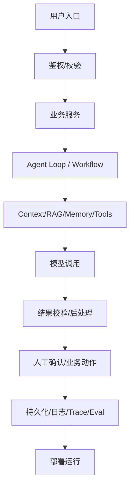

# 项目全景图 · 模板

> 复制为 `项目全景图_<项目名>.md` 后填写。阶段一核心产出，阶段二、四会反复引用。
> 图中/表中**只写有证据的组件**，无证据的用 `[待补资料]`。

---

## 1. 一句话定位

- **给谁用**：
- **解决什么问题**：
- **核心输入**：
- **核心输出**：
- **证据**：

---

## 2. 业务流程（原流程 vs 现在的流程）

| 环节 | 原来怎么做 | 项目做了什么 | 仍需人工处理的环节 |
|---|---|---|---|
| | | | |

**业务价值**（无证据不要写数字）：

---

## 3. 系统架构图（Mermaid）

> 按项目实际存在的组件增删节点；不存在的不要画。

---

## 4. 端到端调用链（沿真实代码追）

**核心成功链路（至少一条）：**

| 步骤 | 触发/输入 | 处理的文件:函数 | 输出 | 证据 |
|---|---|---|---|---|
| 1 | | `path:line`（可见才写行号） | | `[代码证实]` |
| 2 | | | | |

**关键失败 / 异常分支（至少一个）：**

| 触发条件 | 处理位置 | 表现 | 兜底/重试/降级 | 证据 |
|---|---|---|---|---|
| | | | | |

**异步 / 持久化 / 人工确认 / 日志评估**（若存在，单列）：

---

## 5. 关键模块表

| 模块 | 作用 | 入口文件 | 核心函数/类 | 输入 | 输出 | 上游 | 下游 | 证据等级 |
|---|---|---|---|---|---|---|---|---|
| | | | | | | | | |

---

## 6. 运行方式与最小验证路径

- **启动**：
- **配置**（只写变量名/位置，不写密钥值）：
- **最小成功路径复现步骤**：
- **可运行的测试**：
- 若不可运行，说明原因并给出静态阅读替代方案：

---

## 7. Agent 机制核对（仅当项目涉及 Agent 时填）

> 只勾选项目**实际存在**的机制，不存在就写「无」。

| 机制 | 是否存在 | 代码位置 | 说明 |
|---|---|---|---|
| Agent Loop / Workflow | | | |
| Tool Calling / 工具注册 | | | |
| 上下文管理 | | | |
| 检索 / RAG | | | |
| 记忆 | | | |
| 权限 / 安全 | | | |
| 人工兜底 | | | |
| 评估 (Eval) | | | |
| 观测 / Trace | | | |

> 若只是普通 API / Workflow / RAG / 规则逻辑，**如实说明**，不要硬套 Agent。

---

## 8. 当前无法确认的部分

| # | 缺什么 | 影响哪些结论 | 补法 |
|---|---|---|---|
| 1 | | | |
